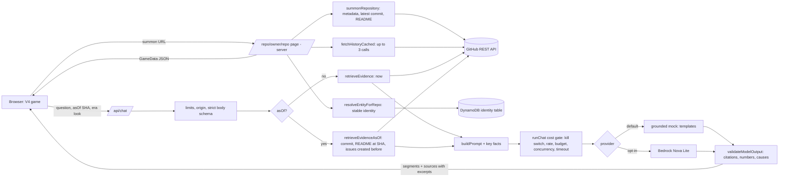

# V5: working end-to-end demo

The V4 game is now the main screen. Summon a real public repository, meet its ghost, ask it questions grounded in real GitHub evidence, open the evidence, and travel to an earlier commit. No fixture-only prototype control is involved.

## Launch it locally

```bash
npm run build
SUMMON_PAGE_LIMIT=500 GITGHOST_CHAT_REQUESTS_PER_MINUTE=60 npx next start -p 3100   # the two overrides only loosen local rate limits for a demo
# open http://localhost:3100
```

- `.env.local` already holds `GITHUB_TOKEN`, the AWS profile/region and the identity table. Replies stay on the **scripted provider** (`GITGHOST_CHAT_PROVIDER=mock`): real GitHub evidence, fixed templates, no AI model, no cost.
- Without a `GITHUB_TOKEN`, GitHub allows 60 requests per hour and a few summons will exhaust it. Keep the token set for the demo.
- Offline or without AWS: open `http://localhost:3100/demo` (invented data, every screen labelled Mock). Error screens link to it.
- The classic screen is still at `/repo/<owner>/<repo>?ui=classic`. The old prototype is still at `/prototype/v4` when `GITGHOST_PROTOTYPES=1`.

## 2 to 3 minute walkthrough (repository: `microsoft/VisualStudioUninstaller`)

Verified: public, archived, 76 commits (history read in full), README, 44 open issues, archived since 2019-02-20.

| Time | Do | Say |
| --- | --- | --- |
| 0:00 | Landing page. Paste `github.com/microsoft/VisualStudioUninstaller` and press Enter. | "Every repository has a ghost. This one is real." |
| 0:15 | The ghost appears, named for the repo; the banner says Live and "replies: scripted, no AI". Point at Spirit Record: saved identity, archetype. | "Same ghost every visit, saved by the repository's numeric ID." |
| 0:30 | Click the first starter, "Why did you die?" | Facts come out as Record lines with source chips; the ghost's own voice stutters. |
| 0:55 | Click a source chip. A drawer opens on the exact text (type, source, excerpt, "Open on GitHub"). The ghost stays visible. Press Escape. | "Every fact is checkable. The ghost's theatre is kept apart." |
| 1:15 | In the Memory Journal (right), click a commit from around 2016. On a phone, open the Journal button first. | "Time travel. No mode switch." |
| 1:30 | The sweep runs, the ghost transforms (12 drawn frames) if its look changes. The stage chip shows the commit and "older era". | "Its look per era is a storytelling convention, not a finding." |
| 1:45 | Ask "What happened during this time?" The note says "Answered as of commit ...; nothing after it was read." | "It cannot know the archive flag or anything later." |
| 2:10 | Click the earliest commit ("Initial commit"), then "Return to present": the saved form is back. | |
| 2:30 | Open "Open Spirit Mirror" in the Haunted Archive (left). | "Facts and interpretation never mix." |

**Layout (V5.2).** One scene, no bottom action bar and no tabs: Haunted Archive (left), ghost with the RPG dialogue and free-form input (center), Memory Journal (right). Suggested questions fold away under the input. On phones the Archive and Journal open as drawers. Only the journal list and the conversation scroll; the page does not.

Backup repositories: `square/cube` (101 to 200 commits, history read in full), `atom/atom` (38,533 commits: only the oldest and newest are read, and the screen says so).

## Phase 0: integration checklist

**Already implemented and verified (reused, not rebuilt)**
- GitHub REST adapter (`src/server/github`): URL parsing, numeric repo ID, metadata, latest commit, README at a SHA, rate-limit and error codes. It is **not** the GitHub MCP.
- Bounded evidence retrieval with namespaced IDs (`src/server/evidence`), validated citations, strict model-output contract, injection guards (`src/server/chat/grounding.ts`, `prompt.ts`).
- Chat gate with cost controls (`runChat`): config, flag, kill switches, rate limits, atomic daily budget, concurrency, timeout, reconcile.
- Providers: grounded mock (default) and Bedrock (`providers/bedrock.ts`, `runtime.ts`), disabled by default.
- Stable identity: DynamoDB `gitghost-entity-assignments`, conditional put, cache, provisional fallback. Working in this environment (identity shows as saved).
- Offline tests for all of the above; four Nova Lite stages already run once (see `docs/history/NOVA_LITE_2C2.md`).

**Implemented in V5 (new)**
- `src/server/github/history.ts`: real commit history, at most 3 GitHub calls, exact total from the Link header, sampled and labelled when longer than 200 commits.
- `src/server/evidence/era.ts`: evidence as it stood at one commit (commits by ancestry, README at the SHA, issues and pull requests by `created:<=` with state reconstructed, no present-day facts, no bodies or comment counts, a final no-future filter).
- `/api/chat` accepts optional `asOf` (40-hex SHA) and `eraStage`; the server verifies the SHA belongs to the repository. The answer reports `asOf`; citations carry the retrieved excerpt.
- V4 reads a single `GameData` shape: real data from the repository page, invented fixtures only for `/demo` and `/prototype/v4`.
- `/repo/<owner>/<repo>` renders V4 by default (`?ui=classic` keeps the old screen); `/demo` is the labelled offline fallback.

**Implemented but not connected**
- GitHub MCP: not present anywhere in the code (only mentioned in planning docs). Connecting it would add a second GitHub path for no demo benefit; the REST adapter does everything needed today. Not done.

**Missing / not done**
- Live Bedrock in the app (see below), by instruction.
- Comparing two eras in one answer (the server only answers from one era at a time).
- Persisting chat history (it lives in the browser tab).

**Blocked by configuration or permissions**
- Live Bedrock: the shared kill switch `KILL#bedrock` is ON, `GITGHOST_BEDROCK_ENABLED=false`, and today's single allowed request is already used (the cap is 1 per UTC day; resets 2026-11-02 00:00 UTC). `.env.local` also lacks the price variables and usage table the app needs, and its `BEDROCK_MODEL_ID` is not the approved Nova ID.

## Architecture



## What is real, what is theatre

- Record lines cite evidence retrieved from GitHub; a claim whose number, date, version or cause is not in its cited evidence is dropped by the server. Reading lines are interpretations of cited evidence. Not found lines say what was not retrieved.
- Ghost lines are fiction in the ghost's voice and carry no facts. They stutter on screen; screen readers get the whole sentence. Records never glitch.
- The ghost's appearance per era (human, distorted, saved form; expression) comes only from the commit's position in the timeline and its SHA. Fewer than three commits show the saved form throughout. The latest era always shows the saved form.
- Time Travel limits: issue and pull request titles can have been edited after the commit; bodies and comment counts are not used for that reason. The README is the real file at that SHA. Present-day facts (archived flag, last push, stars, language) are never given to the model for an earlier era.

## Going live with Bedrock (NOT done, needs your approval)

Read-only preflight (`bash infra/history/2c2/nova-preflight.sh`) today: 17 of 18 checks pass. Passing: table, TTL, restricted role, budget guard, `amazon.nova-lite-v1:0` active in us-east-2, approved IAM policy, offline tests. The one failure is the daily request allowance.

To run a bounded smoke test through the app after approval you would need all of:
1. Wait for the allowance reset (or explicitly decide to change the cap; I have not touched it).
2. Unlock `KILL#bedrock` for the run only and re-lock after (the existing `infra/history/2c2/nova-run.sh` does this).
3. Set in the shell, not in `.env.local`: `GITGHOST_CHAT_PROVIDER=bedrock`, `GITGHOST_BEDROCK_ENABLED=true`, `BEDROCK_MODEL_ID=amazon.nova-lite-v1:0`, `AWS_REGION=us-east-2`, `AWS_PROFILE=gitghost-smoke` (the restricted role, not the admin profile), `GITGHOST_USAGE_TABLE=gitghost-usage-counters`, the two price variables from `docs/history/NOVA_LITE_2C2.md`, and the existing limits.
4. Ask one question; confirm the note under the reply reads "Written by an AI model".

## Known limitations

- Replies are scripted until Bedrock is approved. They are real evidence in fixed templates, so wording repeats.
- Commit history longer than 200 is sampled from both ends; the screen says how many commits exist and that the middle was not read.
- Issues are searched with the GitHub search API (30 requests per minute with a token). A failure shows as a gap in the answer, not as an empty past.
- On a phone the dialogue window is small; long answers scroll inside it.
- The ghost art covers one archetype (the Archivist) for every repository.
- The saved form is `distorted` or `transformed`; the earliest era is always human even for a repository that was never abandoned. That is a presentation rule, not a claim.
- Not audited: real screen readers, long sessions, behaviour on repositories with private or renamed history.

## Verification (this machine, 2026-11-01)

- `npm run typecheck` clean; `npm run lint` clean; `npm test` 757 passed, 4 skipped (46 new for V5).
- `scripts/v5-demo.mts` against real GitHub (`microsoft/VisualStudioUninstaller` and `atom/atom`): 42 checks pass on each, desktop and mobile, including contrast, 12 px minimum text, focus ring, keyboard shortcut, source links, era-scoped answers, reduced motion.
- `scripts/v5-failures.mts`: 18 checks pass (provider failure and retry, rate limit, dropped connection, unknown repository, GitHub unavailable, labelled offline demo).
- Classic checks (`scripts/browser-check.mts`, `scripts/chat-browser-check.mts`, now opening `?ui=classic`) exit 0 with no contrast failures, no overflow and no console errors.
- Screenshots: `docs/history/screenshots/v5/final/`, `.../final/failures/`, `.../atom/`.

## V5.3: the uncanny pass

What changed on top of V5.2 (no change to the GitHub adapter, grounding, identity storage, Bedrock settings or cost controls):

- **Encounter.** The Spirit Mirror, the suggested-questions panel and the Ghost / Record / Memory labels are gone from the normal view. The dialogue is the portrait, the ghost's words, one input and up to three small inline prompts. Records still look different from the ghost's voice (plain slip with a gold edge against italic speech), and screen readers still hear "Record:", "Ghost:" and "You:". Each answer carries one quiet line: what wrote it and, for an older era, the commit it was held to. The archive panel is short: repo, description, GitHub link, status, era.
- **Developer view.** Add `?dev=1` to see the labels, the full reply note, the emotion, the identity state and the storytelling note.
- **Landing.** A dark graveyard with mist and a flickering title. The six featured repositories are drifting shadows with only their name showing. Hover, keyboard focus or (on touch) simply scrolling to them shows the summary, status, last push, Summon and GitHub. The shapes are generic silhouettes, not the repository's ghost.
- **Sound.** All synthesised with Web Audio, no files. Off by default and never autoplays. The toggle (top right, 44px) turns on a quiet wind-and-drone bed on the landing and small retro effects for hover, select, summon, opening a source, choosing a memory and a transformation. The choice is remembered in `localStorage` (`gitghost.sound`). Without Web Audio it does nothing.
- **Forms.** Human, **gory** (blood, torn cheek, hanging jaw, exposed ribs) and **eldritch** (bloodless violet figure, a face that is a pocket of night with stars and several eyes, tendrils at the sides; no teeth, no flesh). Same hood, book and clasp in all three.
- **More ghosts.** The Watchkeeper (a man in a peaked cap with a lantern) and a hound, each with all three forms, 6 expressions x 6 states and the 12-frame transformation. Their expressions change eyes, lids, brows and mouth only. Chosen from the saved origin: watchkeeper -> Watchkeeper, radio-operator -> hound, everything else -> Archivist. Preview without a real repository: `/demo?sprite=watchkeeper` or `/demo?sprite=hound`.

Regenerate art: `node scripts/art/v4-archivist.mts` then `node scripts/art/v4-variants.mts`.
Browser checks: `node scripts/v53-checks.mts <base> <outDir>` plus the V5 scripts. Screenshots: `docs/history/screenshots/v5-3/final/`.

Known limits: the Watchkeeper and hound have no blood-drip animation and their expression range is narrower; the Clockmaker still uses the Archivist body; sound has been checked with a recording stand-in, not by ear; screen readers and browsers other than Chrome are untested.

## V5.4: immersion and worldbuilding

No change to the GitHub adapter, grounding rules, identity storage, Bedrock configuration or the memory journal's behaviour.

- **Proof, quietly.** Evidence is still fully supported, but the reading flow shows only a small pixel seal after a sourced line. It opens a "Records" drawer with every source behind that line (type, retrieved text, GitHub link, the era it was read for). The ghost, its words and the input carry the screen. Each seal has an accessible name ("Open records for this line: ...").
- **Archive.** Repository, "Haunts the iron works" (a cosmetic place), a short description, GitHub link, status and era. No archetype wording; `?dev=1` still shows archetype, scene, identity state and notes.
- **One way back.** "Return to present" appears once, on the era banner over the stage (it is always visible, also on phones). The journal only says the memory is older.
- **Retro framing.** Pixel corner studs on the panels and the dialogue, a beveled nameplate, a `▶` command line, menu-style prompts. Pixel fonts for titles, labels and buttons; the ghost's words and the records stay in the readable body font at 16 to 19 px. The type-in reveal is unchanged and respects reduced motion.
- **Repo-themed haunts.** `src/components/v4/scene-theme.ts` picks one of six backdrops from the repository's name, description, topics and language (whole words only, deterministic): the old graveyard, the wire fields (network/API: radio masts, pylons), the glass ruins (frontend/UI: a giant browser window, a cursor), the iron works (infra/devtools: cooling towers, gear, crates), the observatory (data/AI: dome and monoliths), the signal shore (file sharing/communication: lighthouse, mailboxes). Same sky, ground, lantern and fog; a different landmark and props plus a faint mood tint. Cosmetic only; it states nothing about the project. Art: `node scripts/art/scene-themes.mts`.
- **Species.** A watchkeeper or radio-operator identity keeps its own body (watchkeeper, hound). Other origins take the body that suits the scene (network/communication: hound; infra: watchkeeper; the rest: archivist). Same repository, same haunting, every visit. For example `microsoft/VisualStudioUninstaller` is a watchkeeper in the iron works. Preview without GitHub: `/demo?scene=network&sprite=hound`.
- **Landing.** The six featured repositories are their saved ghosts (read-only lookup, 1.5 s limit, fixed fallback look if the table cannot be read), walking and turning in the fog, half hidden by stones and fences. Hover or keyboard focus brings one into the light with its name, status, Summon and GitHub; on phones two per row with actions visible. Clicking the ghost summons it; keyboard users use the labelled Summon link.
- **Summoning.** Fog rises, the lantern gutters, the screen goes dark (about 0.9 s, with the existing summon sound), then the encounter comes up out of the dark and the ghost rises (about 1.3 s). A one-time flag means a refresh or a direct visit plays nothing. With reduced motion there is no animation at all and the page changes immediately. Screen readers hear "Summoning".

Checks: `node scripts/v54-checks.mts <base> <outDir>` (55 checks) plus the V5, V5.3 and V6 scripts. Screenshots: `docs/history/screenshots/v5-4/`. Known limits: the landing's ghost looks are the saved ones only while the identity table is reachable; the near layer (tombstones, lantern) is shared by every backdrop; the six scene heuristics are word lists, so a repository can land in an odd family (that is only a mood).

## V6.1: final visual pass
- **Landing.** Six unrevealed presences (three generic shadow shapes) wander the fog. No names, status, metadata or drawn characters are shown before summoning, and none are in any accessible name ("Approach presence N of 6"). Mouse, touch or keyboard selects one; the summon veil plays (none with reduced motion); the real character appears only inside the encounter. The manual summon form stays.
- **Encounter.** One framed dialogue window: the ghost's words, plain facts with a thin gold rule, a small seal where there is a source. The seal opens the Records drawer (a top sheet on phones, so the dialogue and input stay in view). The dialogue no longer quotes commit messages in its opening lines. The header shows only a quiet provider badge; `?dev=1` brings every label back.
- **Targeted checks:** `node scripts/v61-checks.mts <base> <outDir>` (57 checks at 1440x900 and 390x844) on a mock-pinned server (`infra/history/v6/serve-mock.sh`). Screenshots: `docs/history/screenshots/v6-1/before` and `docs/history/screenshots/v6-1/after`.
